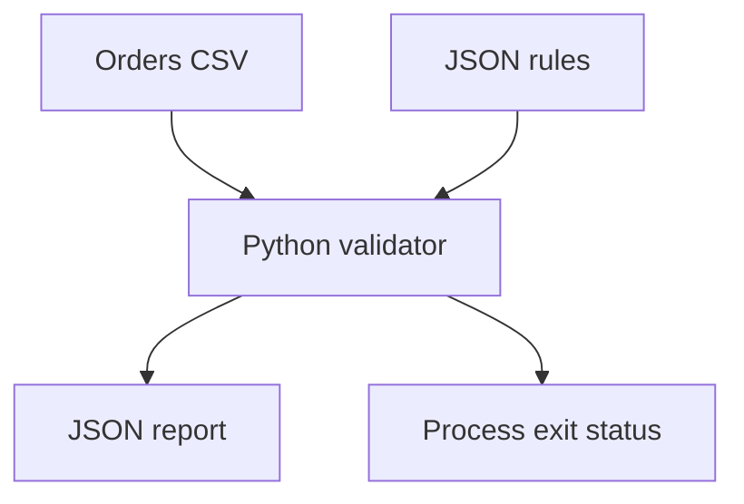

# Data Quality Validation Framework

Check an orders CSV against a reusable JSON contract before loading it into a downstream system. The validator reports missing columns, blank values, duplicate IDs and invalid amounts.

## Architecture



## Get started

1. Install Python 3.10 or newer. No external packages are required.
2. Clone this repository and open a terminal at its root.
3. Run the passing sample.

   ```sh
   python validate.py data/orders.csv
   ```

4. Open `output/report.json`. Expect `passed: true`, three records and an empty errors list.
5. Run the failing sample and open its separate report.

   ```sh
   python validate.py data/invalid.csv --report output/invalid.json
   ```

   Expect three rejected records covering a duplicate ID, a blank region, a negative amount and a non-finite amount. The process exits with status 1 when the report fails and 0 when it passes.

## Change the contract

Copy `rules.json`, edit the required headers, unique key and numeric lower bounds, then select the copy with `--rules`. Include every unique or numeric field in the required list. Use the record numbers in the report to locate data rows, starting at 1 after the CSV header. Use `--report` to save results from multiple inputs side by side.
